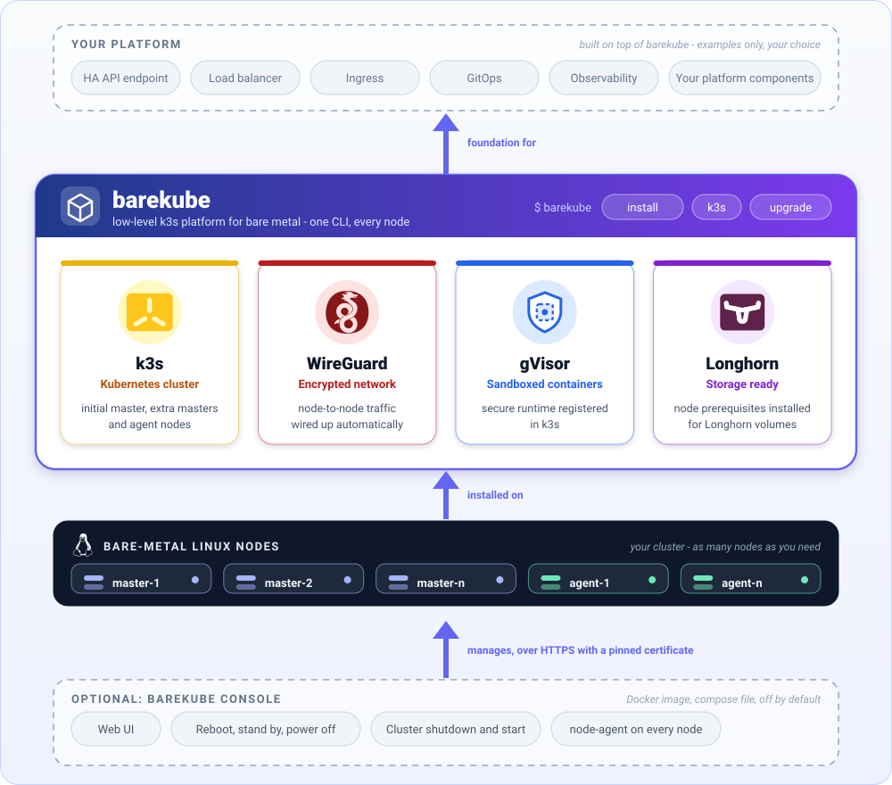

# Barekube - bare-metal kubernetes platform

Barekube is the low-level foundation of a bare-metal kubernetes platform tailored for home setups, IoT and Edge. A single CLI turns plain Linux nodes into a secure k3s cluster, ready for you to build your own platform on top.

<p align="center">
  <picture>
    <source media="(prefers-color-scheme: dark)" srcset="assets/barekube-platform-dark.svg">
    
  </picture>
</p>

What barekube brings:

- [k3s](https://k3s.io/) kubernetes cluster: initial master, additional masters (HA) and agent nodes.
- [WireGuard](https://www.wireguard.com/) network between the nodes.
- [gVisor](https://gvisor.dev/) - security layer for running containers efficiently and securely.
- [Longhorn](https://longhorn.io/) storage prerequisites on the nodes.

Everything above that (HA API endpoint, load balancing, ingress, ...) is up to your platform.

## Installation

To install barekube CLI you simply must do the following steps:

- Download barekube CLI script the destination directory, for instance `$HOME/bin`:

  ```Bash
    mkdir -p $HOME/bin
    wget https://raw.githubusercontent.com/kostiantyn-matsebora/barekube/refs/heads/master/cli/release/barekube -O $HOME/bin/barekube
    chmod +x $HOME/bin/barekube
  ```

- Add an alias to your `.bashrc` or `.bash_profile` file:

  ```Bash
  echo "alias barekube='$HOME/bin/barekube'" >> $HOME/.bashrc
  ```

- Reload your shell:

  ```Bash
  source $HOME/.bashrc
  ```

## Usage

After installation, you can use barekube CLI by running `barekube --help` command in your terminal. It will show you a help message with available commands:

```shell
barekube - CLI that provides functionality for installing and configuring bare kubernetes based on k3s and gVisor.

Usage:
  barekube COMMAND
  barekube [COMMAND] --help | -h
  barekube --version | -v

Commands:
  install                         Install and configure barekube and dependencies
  install dependencies            Install and configure barekube dependencies
  install initial-master          Install and configure k3s initial (first) master node
  install master-node             Install and configure another k3s master node
  install agent-node              Install and configure k3s agent node
  install gvisor                  Install and configure gVisor for existing k3s node
  install longhorn-dependencies   Install and configure Longhorn storage dependencies
  k3s
  k3s start                       Start k3s master node
  k3s stop                        Stop k3s master node
  k3s uninstall                   Uninstall k3s and all related containers
  k3s killall                     Kill k3s and all k3s related containers
  k3s start-agent                 Start k3s agent node
  k3s stop-agent                  Stop k3s agent node
  upgrade                         Upgrade barekube CLI to latest version

Options:
  --help, -h
    Show this help

  --version, -v
    Show version number


MIT License: https://github.com/kostiantyn-matsebora/barekube/blob/master/LICENSE
Copyright (c) 2025 Kostiantyn Matsebora
```

## Running barekube from scripts

By default the install commands ask you questions. To run them from a script, pass the answers as flags and add `--yes`. Barekube then stops with an error if something is missing, instead of waiting for you to type it.

The join token is not a flag. Put it in the `K3S_TOKEN` environment variable, so it stays out of `ps` output and your shell history.

```shell
# First master
barekube install initial-master --yes --tls-san k8s.home.lan --disable traefik

# Another master or an agent
export K3S_TOKEN='<token printed by the first master>'
barekube install master-node --yes --server https://192.168.1.10:6443
barekube install agent-node  --yes --server https://192.168.1.10:6443
```

When an install command finishes it prints `installed` or `already installed`, so a script can tell whether anything changed.
