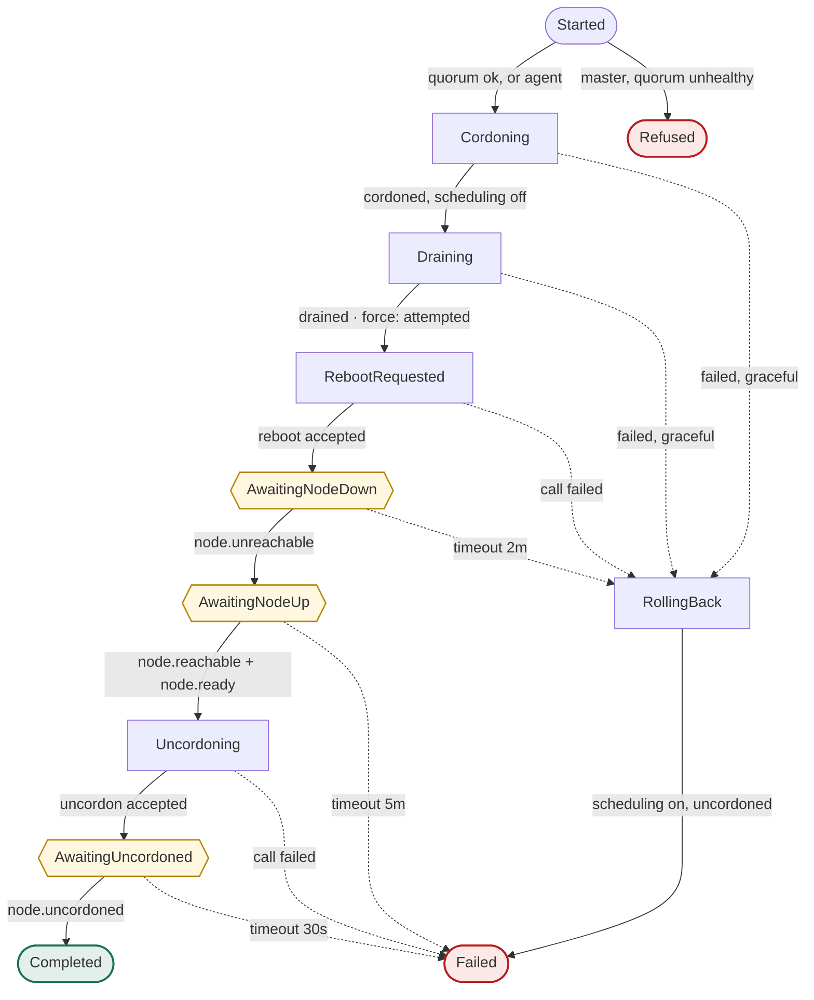
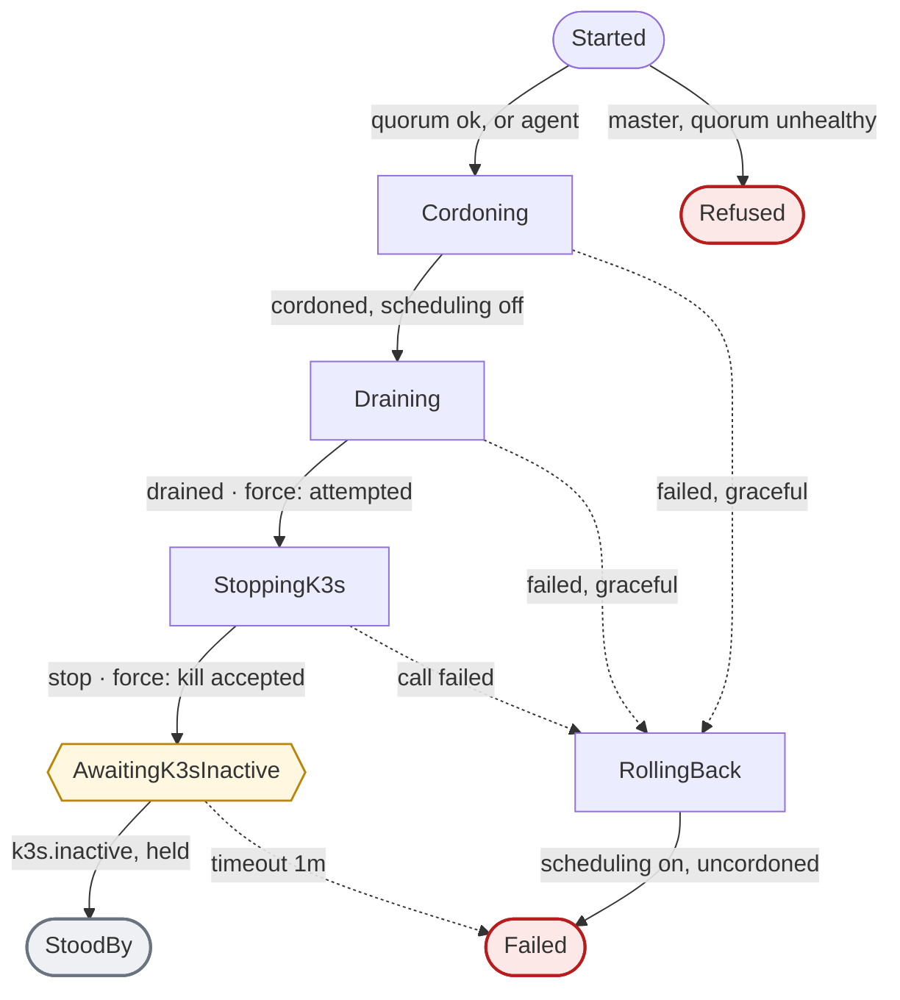
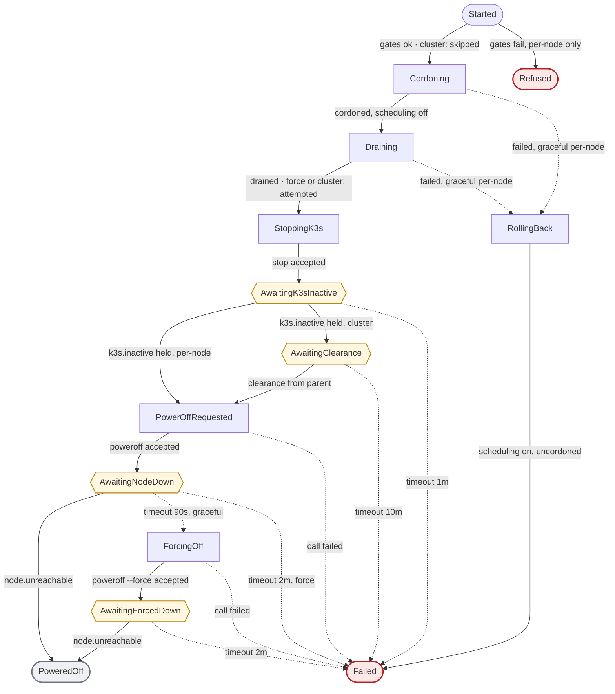
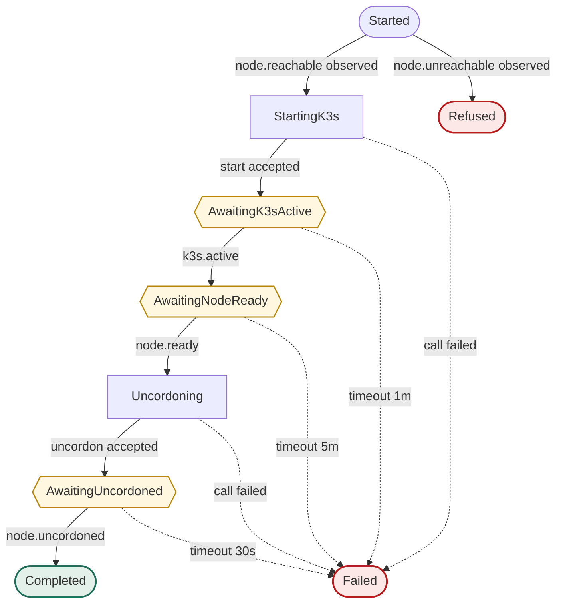
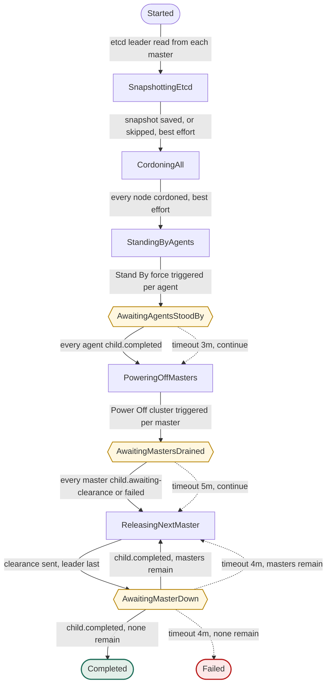

# Console workflows (built 2026-10-31)

Every console operation becomes a declarative workflow built on
[`luno/workflow`](https://github.com/luno/workflow). Each one is a status graph.
A step moves a run from one status to the next **only on an observed event**,
never on the assumption that an action worked.

This page is the design the code in `console/internal/flows` implements.
The UI draws each diagram from the same declaration that runs the workflow, so the UI
is always right. The diagrams below are a snapshot of that declaration.

## Build status

| Part | State |
|---|---|
| Observer, event log, typed events | built, 100 % covered |
| Five workflows on `luno/workflow` | built, every branch tested on a simulated cluster and fake clock |
| Node table, runs panel, live graph, event log, phone layout | built |
| `POST /etcd/is-leader`, `POST /api/cluster/shutdown` with the automation token | built |
| Kubelet Graceful Node Shutdown on the nodes | not done, see Node prerequisites |
| An automation that calls the shutdown | outside this repository |
| Local etcd snapshot as the first step of the cluster shutdown | built, best effort, `clusterShutdown.snapshot` turns it off |
| Etcd snapshot copies off the node to Azure, restore runbook | not done, deliberately after the shutdown work |

Two diagram edges differ from the first drawing, and the code is right.
Power Off also rolls back from `StoppingK3s` when the stop call fails.
The cluster workflow ends in `Completed` directly when no masters are left.

## Why a framework

| Need | How `luno/workflow` covers it |
|---|---|
| Declare a saga as statuses and transitions | `Builder.AddStep(from, fn, to...)`. A step may only return a declared destination |
| Wait for an external event | `AddCallback(status, fn, to...)`. Delivered by `Callback(ctx, foreignID, status, payload)` |
| Give every wait a deadline | `AddTimeout(status, timer, fn, to...)`. The earliest timer wins |
| Trigger one workflow from another | `Trigger` on the child. The child's hooks and steps call back into the parent |
| Run with no server and no database | In-memory record store, streamer, timeout store and role scheduler |
| Test a whole workflow with fakes | `workflow.Require`, `WaitFor`, `TriggerCallbackOn`, a fake clock through `WithClock` |
| Draw the graph | `CreateDiagram` writes a mermaid state diagram |

**Cost.** The console stops being stdlib plus yaml.v3 only. The new module pulls
`google/uuid`, `prometheus/client_golang`, `k8s.io/utils` and `protobuf`. It also
needs Go 1.26, so the Dockerfile moves to `golang:1.26-alpine`.

## Event model

Nothing in the cluster pushes events except the node-agent heartbeat. So the
console makes its own by observing.

### Node observer

One goroutine per node, polling every `observeInterval`. Fast while a run is in
progress on that node, slow at rest.

| Probe | Source | Facts |
|---|---|---|
| `/ping` | the node's own node-agent | `reachable` |
| `/k3s/status` | the node's own node-agent | `k3sActive` |
| `/kubectl/node-ready` | any master, through the pool | `ready` |
| `/kubectl/cordoned` | any master, through the pool | `cordoned` |
| heartbeat push | the node's own node-agent | `reachable`, `k3sActive`, immediately |

A probe that cannot answer leaves its fact **unknown**. It is never guessed. After
quorum is lost, `ready` and `cordoned` are unknown and only `reachable` and
`k3sActive` still drive transitions.

Every poll produces an **observation**.

- The observer delivers it to every workflow as a callback on each waiting status.
- A waiting status evaluates the observation and either moves on or stays.
- Only a change between two observations is written to the event log.

| Event | Meaning |
|---|---|
| `node.unreachable` / `node.reachable` | node-agent stopped or started answering |
| `k3s.inactive` / `k3s.active` | the k3s unit changed state |
| `node.notready` / `node.ready` | the Kubernetes node condition changed |
| `node.cordoned` / `node.uncordoned` | the node's schedulable flag changed |

### Workflow events

A parent workflow never polls its children. A child reports back:

| From | To | Event |
|---|---|---|
| child `OnComplete` hook | parent callback | `child.completed` with the child's final status |
| child step entering `AwaitingClearance` | parent callback | `child.awaiting-clearance` |
| parent step | child callback at `AwaitingClearance` | `clearance` |

### Action events

A step that calls the node-agent records `ok` or `failed` and the error text.
In **force** mode a failed preparation step is recorded and the run continues.
In **graceful** mode it rolls back.

## Generic by configuration

The console must run against any k3s cluster that has the node-agent on every
node. Nothing about this cluster lives in code.

| Concern | Where it lives | Today's value |
|---|---|---|
| Nodes, IPs, roles, node-agent port | `config.yaml` `nodes:` | from the inventory, with the Ansible export |
| Which operations a node supports | `config.yaml` `operations:` and `--operations` of the node-agent | agents omit `poweroff` |
| k3s unit name per node | node-agent flag, set by `barekube install node-agent` | `k3s` or `k3s-agent` |
| Longhorn checks | feature-detected on the node-agent | present |
| Every timeout and poll interval | `config.yaml` `timing:` | the table below |
| Cluster shutdown policy | `config.yaml` `clusterShutdown:` | agents stand by, masters power off, leader last |
| Who may start a cluster shutdown | `CONSOLE_AUTOMATION_TOKEN` | any automation that holds it |
| Where the console runs | any host that outlives the cluster | the Docker image, with compose |

### Cluster shutdown policy

```yaml
clusterShutdown:
  agents:  { action: standby, mode: force }    # standby | poweroff
  masters: { action: poweroff, mode: graceful, forceAfter: 90s, leaderLast: true }
  cordonAll: true
  waits: { agents: 3m, mastersDrained: 5m, masterDown: 4m }
```

- **An agent that supports `poweroff`** may be configured to power off instead
  of standing by. Agents cannot by default, so they stand by.
- **`leaderLast`** uses the node-agent's etcd leader probe. A cluster without
  embedded etcd reports no leader and masters go in config order.
- **A single-master cluster** runs the same workflow with one master.

### What stays out of the code

- **No node names.** Workflows take the node from the run object and the roles
  from config.
- **No home automation.** The trigger is a bearer token on one route. Any
  automation can be the caller; it lives outside this repository.
- **No router.** The container image is a static binary. Where it runs is a
  deployment choice.
- **No Longhorn requirement.** The replica gate is skipped when the CRDs are
  absent, as today.

The gates, the observer and the five workflows are the generic part.

## Timeouts and fallbacks

| Wait | Deadline | On timeout |
|---|---|---|
| node goes unreachable after reboot | 2 min | roll back, `Failed` |
| node reachable and Ready after reboot or rejoin | 5 min | `Failed` |
| k3s inactive after stop or kill | 1 min | `Failed` |
| k3s must stay inactive before the wait resolves | `settle`, 15 s | the wait starts over |
| k3s active after start | 1 min | `Failed` |
| node uncordoned | 30 s | `Failed` |
| graceful power off goes unreachable | 90 s | `ForcingOff` |
| forced power off goes unreachable | 2 min | `Failed` |
| child reports back, cluster shutdown | per phase, below | continue with what answered |

## Gates

| Gate | Per-node graceful | Per-node force | Cluster shutdown |
|---|---|---|---|
| etcd quorum healthy on all masters | required | required | **bypassed**, losing quorum is the goal |
| no volume drops to zero healthy replicas | required | skipped | **bypassed**, every replica goes down |

The two bypasses are the owner's decision from 2026-10-31 and apply to the
cluster workflow only. A per-node operation never bypasses the quorum gate.

## Workflows

| Shape | Meaning |
|---|---|
| box | a step that calls a node-agent |
| hexagon | a wait, resolved only by an observed event |
| solid edge | observed event or action result |
| dotted edge | timeout or failure |
| rounded | terminal status |

### Reboot

Object: node, mode.



The old "rejoining right after drain" display is gone. `AwaitingNodeDown` only
leaves on an observed `node.unreachable`.

### Stand By

Object: node, mode.



### Power Off

Object: node, mode, cluster flag, parent run.



Force mode enters `PowerOffRequested` with `--force` already set, so its
`AwaitingNodeDown` has no graceful fallback left and fails at 2 minutes.

### Rejoin

Object: node.



`Started` reads the current observation rather than a fresh ping. A node whose
k3s already auto-started after a manual power-on passes `AwaitingK3sActive` on the
next observation, because the status evaluates the whole observation, not only a
change.

### Cluster shutdown

Object: mode, agents, masters, per-child status, etcd leader.

Triggered by the owner from the UI or by an automation with its own token.
Composes the per-node workflows as steps.



Sequence as seen from the nodes:

1. Save a local etcd snapshot on a master. A failure is logged and the run goes on.
2. Cordon all five, so nothing reschedules during the run.
3. Agents stand by in parallel, force mode. They stay powered.
4. All three masters drain in parallel while quorum still exists. Each master then
   stops k3s and waits for clearance.
5. Masters power off one at a time. The raft leader goes last. Graceful first, then
   `--force` after 90 seconds, inherited from the Power Off workflow.
6. An automation that runs in the cluster dies during step 4 or 5. The console
   runs outside the cluster, so it finishes the run.

Startup stays manual. Masters are powered on by hand, and nodes that cannot be
powered on remotely are rejoined from the console.

## One root workflow at a time

The console runs **one root workflow at a time**. A root is any workflow started by a
person, by automation, or by the cluster shutdown. A second root is refused with a 409,
whatever node it targets.

- **Sub-workflows are exempt.** The runs a root starts for its nodes are children, not roots.
- **A finished root frees the slot.** `Completed`, `Failed` and `Refused` all count as finished.
- **Stand by and power off are idempotent.** A node already seen stood by or off is
  refused with `nothing to do`, so a repeated automation call does nothing.
  The same goes for a cluster shutdown when every node is already parked.

## A stop must hold

A single `inactive` reading proves nothing.

What happened on agent-2:

1. Force mode killed k3s. The unit has `Restart=always` with `RestartSec=5s`.
2. One `inactive` reading arrived, and the run reported `StoodBy`.
3. systemd restarted k3s five seconds later.
4. The node never stayed parked, so the automation started four runs in four minutes.

Two rules fix it:

- **The node-agent stops after it kills.** `POST /k3s/kill` runs `systemctl kill` and then `systemctl stop`. The stop cancels the pending restart.
- **The wait needs a held observation.** `AwaitingK3sInactive` resolves only when every fresh observation over `timing.settle` (15 s) says k3s is inactive. One reading of active starts the clock over.

The same wait is used by Stand By and by Power Off, so both follow the rule.

## State and housekeeping

Everything the page shows is kept in one SQLite file, not in memory.
The library's in-memory adapters append every record version and every event for the life of the process.
In a small container that grew it to 361 MiB.

| What | Where |
|---|---|
| Runs and their statuses | workflow record store, the `records` table |
| Workflow timeouts and events | `timeouts`, `stream_events` |
| Event log | `events` |
| Node observations | `node_observations`, the time only (see below) |

**Where the file lives.** `storage.path`, default `/config/console.db`.
In the Docker image `/config` is the `console-data` volume; keep it on a disk that outlives the container.

**Housekeeping.** A purge runs at start and every hour.
It deletes finished runs, completed or expired timeouts, events and outbox rows older than `storage.retention` (24 h).
A run that is not finished is never deleted.
An incremental vacuum then returns the space to the disk.

**A restart abandons live runs.** Nothing is replayed, because replaying a stand by that was already sent would repeat its actions.

- The run is marked `Cancelled` with the reason `console restarted while this run was live`.
- Its pending outbox events and timeouts are dropped.
- Every stream cursor jumps to the newest event.
- The run list still shows it, as failed.

**Node states after a restart.** Only the time of the last observation is kept.
Every fact comes back `unknown` until the first probe, because a reading from before the restart says nothing about the node now.

**Memory limits.** Two settings exist, and neither is a proven hard cap.

- `GOMEMLIMIT` is a soft target for the Go garbage collector. It cannot cap memory the code still holds.
- The compose file sets `mem_limit: 128m` on the container, a hard cgroup limit.

The real protection is that nothing grows. See "Memory report" below.

## Memory report

The console logs one line a minute with three views of its memory.
A container runtime shows only one number, which cannot tell the Go heap from cached files.

| View | Fields |
|---|---|
| Go runtime | `heapAlloc`, `heapInuse`, `stackInuse`, `sys`, `gcs`, `goroutines` |
| Process | `rss`, `anon`, `file`, `shmem` from `/proc/self/status` |
| Container cgroup | `current`, `anon`, `file`, `kernel`, `shmem`, `slab` |

Read it from the container log:

```
docker compose logs console | grep "mem go"
```

**A leak shows as a straight line.** Goroutines and anonymous memory climb every minute with no plateau.
A healthy console sits near 200 goroutines and 20 MiB.

### The leak this found

`nodeagent.Real.do()` built a new HTTP transport for every call and closed the response body unread.
Every probe opened a TLS connection that nothing reused or closed.
The console grew by about 400 goroutines and 10 MiB a minute, and reached 350 MiB.

- **One client per node.** It keeps at most two idle connections and closes them after 30 s.
- **The body is read to the end before it is closed.** A body closed unread cannot be reused.
- **A test holds it.** 40 calls must open one connection.

## Which workflow triggers which

| Parent | Step | Child | Mode |
|---|---|---|---|
| Cluster shutdown | `StandingByAgents` | Stand By, one run per agent | force |
| Cluster shutdown | `PoweringOffMasters` | Power Off, one run per master | graceful, cluster flag |

Children are ordinary runs of the per-node workflows. They show in the UI like any
other run and carry the parent run ID.

## Node table redesign

The current table mixes three things into two columns. `State` carries the
outcome of the last operation, so a node whose reboot timed out shows `fault`
for days while its heartbeat says it is fine. `Message` carries internal
reasoning nobody acts on. Both go.

**A node row shows observed facts only.** The outcome of an operation belongs to
its run in the Runs panel.

| Column | Source | Values |
|---|---|---|
| Node, Role | config | as today |
| State | derived from the latest observation | `healthy`, `cordoned`, `not-ready`, `stood-by`, `off`, `unknown` |
| Reachable | observer | yes, no |
| k3s | observer | active, inactive, unknown |
| Ready | observer, through a master | yes, no, unknown |
| Schedulable | observer, through a master | yes, cordoned, unknown |
| Heartbeat | node-agent push | age, as today |
| Run | the active run on this node | workflow and current status, or empty |
| Actions | config operations | enabled only when no run touches this node |

Derivation of `State`, first match wins:

1. `off` when unreachable.
2. `stood-by` when reachable and k3s inactive.
3. `unknown` when Ready or Schedulable cannot be read.
4. `not-ready` when Ready is false.
5. `cordoned` when Schedulable is false.
6. `healthy` otherwise.

There is no `fault` node state. A failed run is visible in the Runs panel with its
own final status and event log, and a node keeps reporting what it is.

## Event log

The log stops being a list of status writes. It becomes an append-only stream of
typed events, and every view in the console reads from it.

| Field | Content |
|---|---|
| `time` | console receive time |
| `kind` | one of the kinds below |
| `source` | `observer`, `heartbeat`, `run`, `action`, `timeout`, `child`, `ui`, `ha` |
| `node` | the node the event is about, empty for a cluster run |
| `runId`, `workflow` | the run the event belongs to, empty for an observation outside any run |
| `detail` | one line, for humans |

| Kind | Raised by |
|---|---|
| `node.reachable`, `node.unreachable`, `k3s.active`, `k3s.inactive`, `node.ready`, `node.notready`, `node.cordoned`, `node.uncordoned` | the observer, on a change between two observations, or a heartbeat |
| `run.triggered` | a UI click, the HA endpoint, or a parent workflow, with who did it |
| `run.status` | every status transition of a run |
| `action.ok`, `action.failed` | every node-agent call made by a step |
| `timeout.fired` | a wait that expired |
| `child.completed`, `child.awaiting-clearance`, `clearance` | the parent and child reports |
| `run.completed`, `run.failed`, `run.refused` | a run reaching a terminal status |

- **One stream, two views.** The page-level log shows everything. A run card shows
  the events with its `runId`.
- **Filter by node and by run** in the UI.
- **Ring buffer of 2000 events** in memory, same lifetime as today. A console
  restart starts an empty log.
- **Structured on the wire.** `GET /api/events` returns the fields above as JSON,
  not a preformatted line.

## Live view in the console

The UI gains a **Runs** panel under the node table.

- **One card per active run**, child runs nested under their parent.
- **The workflow's own graph**, rendered by mermaid from the same definition the
  code runs, with the current status highlighted and visited statuses dimmed.
- **The run's event log**: observed node events, action results, timeouts and
  child reports, newest last.
- **Finished runs** stay visible for the session with their final status.

The page polls `/api/runs` once a second.
mermaid.js ships inside the binary, so the view works with no internet, which is
the case during the outage it is built for.

## Layout

The page is a tool, operated from a desk and from a phone in the dark. It fills
the viewport and nothing in it needs hover.

### Desktop, 900 px and wider

| Region | Content | Sizing |
|---|---|---|
| header | title, cluster state chip, Shutdown cluster button, event filter | one row, sticky |
| nodes | the node table | content height, left column |
| runs | the run list, newest first | the rest of the left column |
| graph | the selected run's graph, scrolled to its current status | top of the right column |
| events | the event log, pinned to the newest event | the rest of the right column |

- **No outer margin** beyond a 16 px gutter.
- **The event log takes what is left**, so a tall screen shows more log and a
  short one still shows every node and run.

### Phone, under 700 px

| Region | Content |
|---|---|
| header | title, cluster state chip, Shutdown cluster, as one wrapping row |
| nodes | one card per node, stacked |
| runs | one card per run, stacked |
| events | the log, filter chips above it |

- **A node card** shows name, role, state chip, the four fact chips, heartbeat age
  and the active run on one or two lines.
- **Actions open a bottom sheet**, not seven buttons per row. The sheet lists the
  node's operations, a graceful or force choice, and an inline confirm step.
- **A run card shows a status rail** on narrow screens, the statuses as a vertical
  list with the current one marked. The mermaid graph appears from 700 px.
- **Touch targets are 44 px** or larger.

### Both

- **Cluster shutdown needs two taps**, the button and a confirm that names the
  mode.
- **Polling stays at one second**, as today.
- **Dark theme by default**, since the phone case is an outage at night.

## API additions

| Route | Auth | Purpose |
|---|---|---|
| `POST /api/cluster/shutdown` | UI session or `CONSOLE_AUTOMATION_TOKEN` | start the cluster workflow |
| `POST /api/nodes/{name}/{reboot,standby,poweroff,rejoin}?mode=` | UI session or `CONSOLE_AUTOMATION_TOKEN` | start a node workflow |
| `GET /api/runs` | UI session | active and recent runs with their events |
| `GET /api/events?node=&run=` | UI session | the typed event stream, filterable |
| `GET /api/workflows` | UI session | the status graphs, for the diagrams |

`CONSOLE_AUTOMATION_TOKEN` is a third secret. It starts any workflow, through the
same `POST /api/nodes/{name}/{workflow}` routes the UI uses, and the cluster shutdown.
It cannot read state or open the page. A run it starts is logged as `automation`.

## Node-agent additions

| Endpoint | Why |
|---|---|
| `POST /k3s/kill` | kill, then stop, so systemd's `Restart=always` cannot bring k3s back |
| `POST /etcd/snapshot` | masters only, runs `sudo -n k3s etcd-snapshot save --name console-shutdown`, the one command the sudoers rule allows |
| `POST /etcd/is-leader` | reads `etcd_server_is_leader` from the master's local etcd metrics on port 2381, so the cluster workflow can power the raft leader off last |

## Node prerequisites

- **kubelet Graceful Node Shutdown** on all five nodes, 2 minutes with 30 seconds
  for critical pods, plus the matching logind inhibit delay. A plain `poweroff`
  then terminates pods in order without the API.
- The masters' k3s config already carries `etcd-arg: election-timeout=10000`.

## Out of scope for the first build

- Automatic startup after power returns.
- Persisting run history across a console restart. `Reconcile` keeps rebuilding
  node state from reality at startup.
